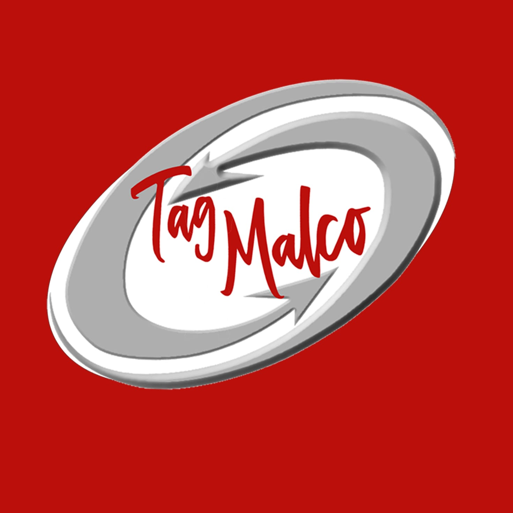

# TAGMALCO
### CASO DE ESTUDIO · TRANSFORMACIÓN DIGITAL

**Dirección del proyecto e implementación tecnológica**

**Kelvin César Del Castillo Torres** · [Perfil profesional: @jokxer8](https://github.com/jokxer8)

🟢 Diagnóstico realizado · 🟢 Migración DNS realizada · 🟡 Desarrollo web en progreso

---

## Resumen del proyecto

Proyecto de transformación digital empresarial organizado por etapas: diagnóstico tecnológico, administración de infraestructura, continuidad de servicios, documentación y preparación del desarrollo web.

Este caso de estudio presenta el avance al **12 de octubre de 2026**. Resume la implementación tecnológica y la dirección del proyecto; las fases futuras se identifican como pendientes.

## Dirección del proyecto

**Responsable: Kelvin César Del Castillo Torres · [@jokxer8](https://github.com/jokxer8)**

| Área de responsabilidad | Trabajo desarrollado |
| :--- | :--- |
| Diagnóstico tecnológico | Levantamiento de plataformas y dependencias para orientar la transformación. |
| Planificación por etapas | Organización del trabajo en hitos, entregables y condiciones de cierre. |
| Coordinación de implementación | Dirección de la migración de administración DNS y de sus verificaciones de continuidad. |
| Documentación | Registro del avance, decisiones y pendientes con control de versiones. |
| Seguimiento | Panel de indicadores y preparación de la siguiente etapa de desarrollo web. |

## Tecnologías y alcance

| Tecnología | Aplicación en el proyecto | Estado |
| :--- | :--- | :--- |
| **Cloudflare** | Administración y migración de autoridad DNS | 🟢 Implementado en esta etapa |
| **GoDaddy** | Continuidad del registro y del sitio existente durante la transición | 🟢 Conservado en esta etapa |
| **Microsoft 365** | Validación de continuidad de correo y colaboración tras el cambio DNS | 🟢 Validado en las pruebas reportadas |
| **GitHub** | Repositorio empresarial, documentación y seguimiento de avances | 🟢 Implementado |
| **Markdown** | Documentación estructurada y panel de estado | 🟢 Implementado |
| **Mermaid** | Representación conceptual de la arquitectura | 🟢 Implementado en documentación |
| **Bolt** | Construcción prevista de la nueva web | 🔴 Sin iniciar según el avance documentado |

## Hitos realizados

### 1 · Diagnóstico tecnológico

Levantamiento inicial de la infraestructura, identificación de dependencias y preparación de prioridades de implementación.

**Entregable:** documentación de auditoría y base para planificar cambios por etapas.

### 2 · Migración de administración DNS

Traslado de la autoridad DNS a Cloudflare, conservando los servicios existentes durante la transición. Se reportaron pruebas correctas de acceso web, correo y colaboración al cierre de la etapa.

**Entregable:** migración documentada y registro de verificaciones de continuidad. Estos resultados son históricos y no representan monitoreo en vivo.

### 3 · Documentación y seguimiento en GitHub

Preparación de un repositorio empresarial con documentación por etapa, registro de decisiones, arquitectura conceptual y panel de seguimiento.

**Entregable:** documentación versionada, navegación entre documentos e indicadores 🟢 realizado, 🟡 en progreso y 🔴 sin iniciar o pendiente.

## Etapa actual y desarrollo pendiente

| Línea de trabajo | Situación |
| :--- | :--- |
| Documentación y seguimiento | 🟡 Actualización continua |
| Definición de contenido web | 🔴 Pendiente |
| Preparación de Bolt | 🔴 Pendiente |
| Construcción de la primera versión | 🔴 Pendiente |
| Revisión y publicación de la nueva web | 🔴 Pendiente |

La puesta en producción de la nueva web y las optimizaciones posteriores no se presentan como resultados ya realizados.

## Competencias demostradas

- Dirección y seguimiento de un proyecto de transformación digital.
- Planificación de implementaciones por etapas y coordinación de continuidad de servicios.
- Administración de cambios en infraestructura DNS.
- Documentación técnica y ejecutiva con control de versiones.
- Comunicación del avance mediante indicadores y entregables verificables.

## Alcance de esta referencia pública

Resumen profesional de la implementación y su dirección. La documentación operativa detallada permanece en el repositorio empresarial privado. Este caso no adjunta configuraciones de producción, inventarios de registros DNS, datos financieros, información de clientes o proveedores, credenciales ni capturas de consolas internas.

**Tipo de evidencia:** relato documentado del avance y atribución de responsabilidad del proyecto. No constituye una auditoría independiente ni una certificación externa.

---

**TAGMALCO · Caso de estudio público**

**Dirección del proyecto:** [Kelvin César Del Castillo Torres · @jokxer8](https://github.com/jokxer8)

